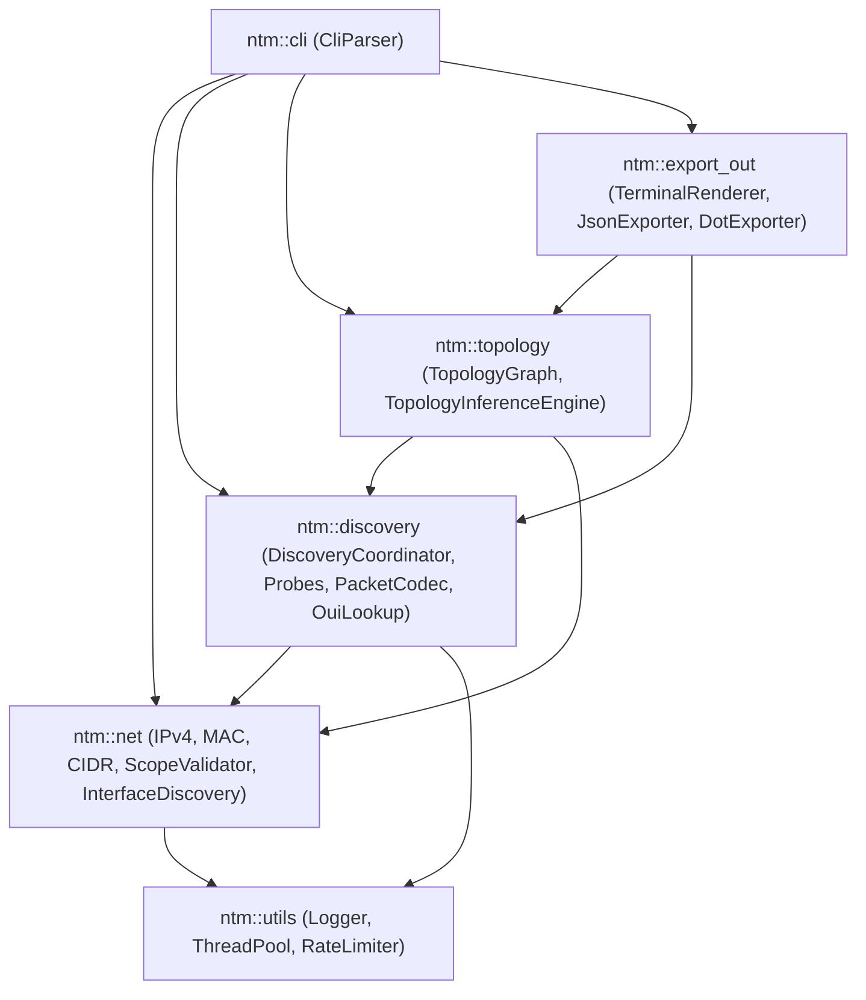
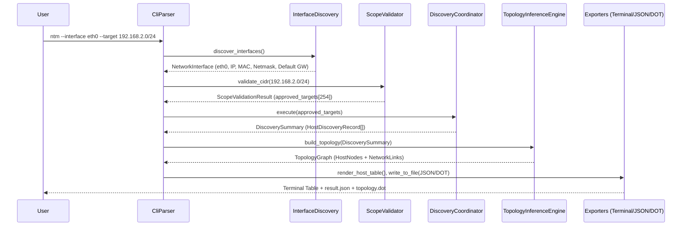

# Kiến trúc Hệ thống Network Topology Mapper (NTM)

Tài liệu này mô tả chi tiết kiến trúc phần mềm, luồng dữ liệu, cơ chế suy luận topology dựa trên bằng chứng, mô hình đa luồng và mô hình bảo mật của **Network Topology Mapper (NTM) v1.0**.

---

## 1. Module Dependency

Kiến trúc của NTM được thiết kế theo mô hình phân lớp một chiều (Directed Acyclic Graph - DAG), ngăn chặn triệt để sự phụ thuộc vòng (circular dependencies) và tách biệt hoàn toàn logic nghiệp vụ cốt lõi khỏi các lệnh gọi hệ thống đặc thù của Linux:

### Trách nhiệm từng phân hệ:
- **`ntm::utils`**: Cung cấp hạ tầng cơ sở độc lập nền tảng gồm `Logger` (đồng bộ bằng mutex), `ThreadPool` (hàng đợi giới hạn kích thước, sử dụng `std::jthread` trên C++20 hoặc `std::thread` tương thích C++17) và `RateLimiter` (kiểm soát tốc độ gửi gói tin theo thời gian thực và giới hạn số probe đồng thời).
- **`ntm::net`**: Xử lý định địa chỉ (`IPv4Address`, `MACAddress`, `CIDRBlock`), khám phá cấu hình mạng của máy chủ (`InterfaceDiscovery`) và kiểm duyệt phạm vi quét (`ScopeValidator`).
- **`ntm::discovery`**: Đóng gói việc tạo/phân tích gói tin nhị phân (`PacketCodec`), giao diện trừu tượng `IDiscoveryProbe` cho các giao thức ARP/ICMP/TCP, trình phân giải PTR DNS (`ReverseDnsResolver`), trình đọc bảng láng giềng (`/proc/net/arp`), tra cứu phần cứng (`OuiLookup`) và bộ điều phối `DiscoveryCoordinator`.
- **`ntm::topology`**: Định nghĩa cấu trúc đồ thị danh sách kề (`TopologyGraph`, `HostNode`, `NetworkLink`) và bộ máy suy luận `TopologyInferenceEngine`.
- **`ntm::export_out`**: Chịu trách nhiệm trình bày kết quả ra bảng CLI (`TerminalRenderer`), tuần tự hóa JSON có phiên bản schema (`JsonExporter`) và sinh mã nguồn đồ thị Graphviz (`DotExporter`).

---

## 2. Data Flow (Luồng dữ liệu)

---

## 3. Discovery Pipeline

Quá trình khám phá một địa chỉ IP mục tiêu tuân theo pipeline đa tầng:

1. **Layer-2 ARP Probe (`ArpDiscoveryProbe`)**:
   - Kiểm tra điều kiện tiên quyết: IP mục tiêu bắt buộc thuộc cùng subnet với interface đang quét.
   - Đóng gói khung Ethernet II (14 bytes) + ARP Request (28 bytes) = 42 bytes thông qua `PacketCodec::build_arp_request_frame`.
   - Gửi qua raw packet socket `socket(AF_PACKET, SOCK_RAW, htons(ETH_P_ARP))` gắn chặt với `sll_ifindex` của interface.
   - Chờ phản hồi không chặn bằng `poll()` với deadline tính theo `std::chrono::steady_clock`.
   - Kiểm tra biên bộ đệm (`length >= 42`), xác thực `EtherType == 0x0806`, `OPER == 2` (ARP Reply) và `Sender IP == Target IP`.
2. **Layer-3 ICMP Echo Probe (`IcmpDiscoveryProbe`)**:
   - Tạo gói ICMP Echo Request (Type 8, Code 0) với `identifier = getpid() & 0xFFFF`, `sequence` tăng nguyên tử (`std::atomic<uint16_t>`) và tính checksum bù 1 16-bit theo **RFC 1071**.
   - Gửi qua `SOCK_RAW` (hoặc fallback sang unprivileged `SOCK_DGRAM` `IPPROTO_ICMP` trên Linux).
   - Khi nhận gói phản hồi, bóc tách IPv4 header dựa trên trường `IHL * 4`, kiểm tra lại toàn bộ checksum ICMP, đối chiếu `identifier`, `sequence`, địa chỉ IP nguồn và tính RTT chính xác tới từng microsecond.
3. **Layer-4 TCP Connect Probe (`TcpConnectProbe`)**:
   - Mở socket `SOCK_STREAM` ở chế độ non-blocking (`O_NONBLOCK`).
   - Gọi `connect()` tới danh sách cổng cấu hình (mặc định: `22, 80, 443, 8080`).
   - Sử dụng `poll()` + `getsockopt(SOL_SOCKET, SO_ERROR)` để phân biệt 4 trạng thái:
     - `Open` (`SO_ERROR == 0`): Cổng dịch vụ mở và host đang hoạt động.
     - `Refused` (`SO_ERROR == ECONNREFUSED`): Host gửi gói TCP `RST` — đây là bằng chứng khẳng định ngăn xếp TCP/IP của thiết bị đang hoạt động dù cổng dịch vụ đóng.
     - `Timeout`: Không có phản hồi trong thời gian chờ.
     - `Error`: Lỗi định tuyến hoặc socket.
4. **OS Neighbor Cache & Enrichment**:
   - Đọc bảng `/proc/net/arp` của kernel để thu thập địa chỉ MAC của các host vừa giao tiếp qua ICMP/TCP (đặc biệt hữu ích khi chạy không có quyền `CAP_NET_RAW`).
   - Thực hiện truy vấn PTR DNS (`getnameinfo` với cờ `NI_NAMEREQD`) cho các host đang hoạt động.
   - Tra cứu nhà sản xuất phần cứng qua `OuiLookup` theo thuật toán **Longest-Prefix Match** (ưu tiên 36-bit MA-S -> 28-bit MA-M -> 24-bit MA-L).

---

## 4. Topology Inference (Suy luận Topology dựa trên bằng chứng)

Nguyên tắc cốt lõi của `TopologyInferenceEngine`: **Không bao giờ đánh đổi tính chính xác lấy một sơ đồ trông có vẻ đầy đủ nhưng sai sự thật vật lý**.

### 4.1. Phân loại Host (`HostClassification`)
Mỗi `HostNode` lưu danh sách `classification_reasons` giải thích rõ cơ sở phân loại:
- **`LocalHost`**: Trùng khớp với IPv4 và interface đang thực hiện quét (`confidence = 1.0`).
- **`DefaultGateway`**: Trùng khớp với địa chỉ Gateway mặc định đọc từ `/proc/net/route` trên interface hiện tại và có phản hồi xác nhận trên mạng.
- **`LANHost`**: Nằm trong cùng subnet với interface cục bộ VÀ có bằng chứng địa chỉ MAC tầng 2 (từ ARP Reply trực tiếp hoặc OS ARP Cache).
- **`ReachableHost`**: Phản hồi ở tầng 3 (ICMP) hoặc tầng 4 (TCP) nhưng không thu thập được địa chỉ MAC tầng 2.
- **`UnknownHost`**: Không phản hồi bất kỳ phương thức thăm dò nào.

### 4.2. Phân loại Liên kết (`NetworkLink`)
- **Tại sao không nối trực tiếp hai LAN Host với nhau?**
  Trong mạng Ethernet chuyển mạch (Switched LAN), việc hai thiết bị `192.168.2.20` và `192.168.2.30` cùng nằm trong `/24` và cùng phản hồi ARP về máy quét chỉ chứng minh chúng thuộc cùng một **Layer-2 Broadcast Domain**. Nếu không có dữ liệu từ giao thức quản lý switch (LLDP, CDP, SNMP Bridge-MIB / Forwarding Database), việc vẽ đường nối trực tiếp giữa `192.168.2.20` và `192.168.2.30` hoặc tự bịa ra số cổng switch là sai kiến trúc mạng.
- Quy tắc tạo cạnh trong v1.0:
  1. **`ObservedLink`** (`Confidence: High`, `0.95 - 0.98`): Khi nhận được trực tiếp gói tin Layer-2 ARP Reply từ thiết bị mục tiêu trên interface cục bộ.
  2. **`InferredLink`** (`Confidence: Medium - High`, `0.60 - 0.88`):
     - Liên kết tới Default Gateway được suy luận từ bảng định tuyến `/proc/net/route` kết hợp phản hồi L3/L4.
     - Liên kết thành viên L2 Broadcast Domain được suy luận từ bảng `/proc/net/arp` kết hợp phản hồi TCP/ICMP.
     - Liên kết L3 Reachability khi thiết bị chỉ phản hồi ICMP/TCP mà không có thông tin MAC.
  3. **`UnknownRelationship`** (`Confidence: Low`, `0.0`): Khi chưa đủ dữ liệu xác minh. Khi xuất sang Graphviz DOT, các quan hệ `UnknownRelationship` bị loại bỏ khỏi tập cạnh hiển thị để không gây hiểu nhầm là kết nối vật lý.

### 4.3. Điểm mở rộng cho v1.1 (LLDP / CDP / SNMP)
Trong `include/ntm/discovery/discovery_engine.hpp`, giao diện `IL2TopologyProtocolPlugin` và cấu trúc `L2NeighborObservation` đã được định nghĩa sẵn. Ở phiên bản v1.1, các plugin LLDP/CDP/SNMP chỉ cần cài đặt interface này để đẩy dữ liệu `ChassisID`, `PortID` và bảng CAM vào `TopologyInferenceEngine` mà không cần sửa đổi `DiscoveryCoordinator` hay `TopologyGraph`.

---

## 5. Threading Model (Mô hình Đa luồng & Đồng thời)

1. **`ThreadPool`**:
   - Khởi tạo một số lượng cố định worker thread (`1..128`, mặc định `8`). Không bao giờ tạo thread mới cho từng địa chỉ IP.
   - Hàng đợi tác vụ (`tasks_`) có kích thước tối đa (`kDefaultMaxQueueSize = 16384`), sử dụng hai biến điều kiện (`cv_task_available_` và `cv_space_available_`) để tạo cơ chế backpressure an toàn.
   - Worker thread chỉ giữ `queue_mutex_` trong vài nanosecond khi lấy `std::function<void()>` ra khỏi hàng đợi; **tuyệt đối không giữ mutex trong suốt thời gian chờ I/O mạng**.
2. **`RateLimiter`**:
   - Tách biệt hoàn toàn khỏi `ThreadPool`.
   - Sử dụng `ScopedProbePermit` theo mẫu RAII: mỗi khi worker chuẩn bị gửi gói tin thăm dò, nó phải xin đồng thời một slot đồng thời (`max_concurrent_probes`) và một khe thời gian gửi gói (`min_interval_ = 1s / max_requests_per_sec`). Khi probe kết thúc (hoặc ném ngoại lệ), destructor của `ScopedProbePermit` tự động trả lại slot.

---

## 6. Error Handling (Xử lý lỗi)

- **Cô lập lỗi theo từng thiết bị**: Mỗi tác vụ quét IP chạy độc lập bên trong `std::packaged_task`. Lỗi socket, timeout, gói tin hỏng hoặc lỗi phân giải DNS ở một IP chỉ được ghi nhận vào `ProbeResult` của riêng IP đó và không bao giờ làm gián đoạn quá trình quét các IP còn lại.
- **Bảo toàn tài nguyên bằng RAII**: Toàn bộ file descriptor của socket trên Linux được quản lý bởi lớp `ScopedFd`, và cấu trúc `ifaddrs*` được bọc trong `std::unique_ptr<ifaddrs, decltype(&freeifaddrs)>`, đảm bảo không bao giờ rò rỉ tài nguyên ngay cả khi xảy ra lỗi sớm.

---

## 7. Security Model (Mô hình Bảo mật & Kiểm soát Phạm vi)

1. **`ScopeValidator` (Kiểm tra bắt buộc trước khi chạy)**:
   - Chặn địa chỉ không xác định (`0.0.0.0/8`), loopback (`127.0.0.0/8`), multicast (`224.0.0.0/4`), limited broadcast (`255.255.255.255`) và dải dự trữ Class E (`240.0.0.0/4`).
   - Chặn mọi địa chỉ IPv4 công cộng (Public Internet).
   - Chỉ cho phép quét các địa chỉ nằm trong đúng subnet của interface đã được chọn (chặn hành vi tự động quét vượt qua default gateway sang subnet khác).
   - Loại bỏ địa chỉ Network Address và Directed Broadcast khỏi danh sách mục tiêu unicast.
2. **Nguyên tắc Đặc quyền Tối thiểu (Least Privilege)**:
   - Khuyến nghị sử dụng `CAP_NET_RAW` (`sudo setcap cap_net_raw+ep ./build/ntm`) thay vì chạy toàn bộ tiến trình dưới quyền `root`.
   - Ở tầng ARP (`ArpDiscoveryProbe::probe`), chương trình kiểm tra kép `iface_.subnet_cidr().contains(target_ip)` trước khi gọi `sendto()`, ngăn chặn tuyệt đối việc phát tán gói ARP ra ngoài phạm vi interface.
3. **Bảo vệ Tài nguyên (Resource Protection)**:
   - Giới hạn số lượng IP mục tiêu tối đa trong một lần quét (`kDefaultMaxTargets = 1024`).
   - Giới hạn số lượng cổng TCP probe tối đa (`32` cổng) để tránh biến công cụ thành trình quét toàn bộ 65535 cổng.
   - Giới hạn kích thước file xuất JSON (`32 MB`) và DOT (`16 MB`).
